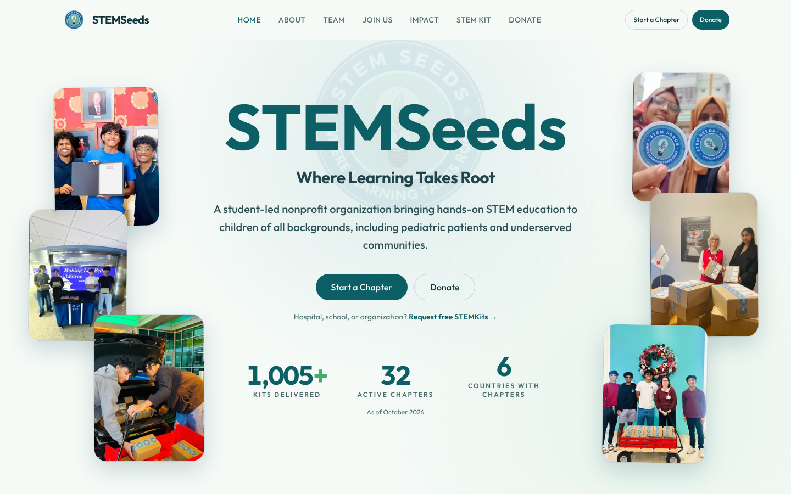

# stemseeds.net

The website for [STEMSeeds](https://www.stemseeds.net), a student-led 501(c)(3)
that designs hands-on STEM kits and delivers them free to kids in hospitals and
underserved communities. 1,005+ kits delivered by 32 chapters in 6 countries.



## What the site does

| Page | For | What's on it |
|---|---|---|
| **Home** | Everyone | Mission, impact counters, how a kit gets from a chapter to a hospital, partners, mayoral recognition |
| **About / Team** | Families, partners | Founders, core team, and every chapter's leaders, grouped by U.S. state and country |
| **Impact** | Donors, press | A timeline of every delivery and fundraiser, newest first, with photos |
| **STEM Kit** | Kids, parents, teachers | The three experiments in each kit, with step-by-step build photos and printable flyers |
| **Request Kits** | Hospitals, schools | A form that sends the request straight to our inbox |
| **Join Us** | Students | How to start a chapter, plus an FAQ |
| **Donate** | Donors | What each donation pays for |

## How it's built

- **Next.js (App Router), React 19, TypeScript and Tailwind CSS v4**, deployed on Vercel.
- **Every page is static.** It's prerendered at build time, so pages load fast and
  there's no server to maintain.
- **Content is separate from layout.** All copy, stats, photos, team members and
  impact events live in typed files in [`content/`](content/). Updating the site
  (a new delivery, a new chapter, a new kit count) means editing data, not
  components, and TypeScript catches a missing field before it ships.
- **Kit requests without a backend.** The request form posts to FormSubmit, which
  forwards it to the STEMSeeds inbox, and it falls back to a plain email link if
  that fails. The phone field has a country picker covering every country with a
  dialing code.
- **SEO and sharing:** page metadata, a sitemap, `robots.txt`, and an Open Graph
  image generated in code, so a shared link shows a STEMSeeds preview card with
  the current impact numbers.
- **Images** are AVIF where possible to keep pages light.
- **Preview branch workflow:** changes go to a preview branch first, get checked
  on its Vercel preview URL, and are merged to `main` (the live site) once
  they look right.

## Project structure

```
app/            one folder per page, plus metadata, sitemap and the OG image
components/     page sections (home/, about/, impact/, ...) and shared ui/
content/        all site copy and data: site.ts, home.ts, impact.ts, team.ts, kits.ts, ...
public/images/  photos, kit build steps, partner logos
```

## Common updates

- **New delivery or event:** add an entry to the top of `impactEvents` in
  [`content/impact.ts`](content/impact.ts) and drop its photos in
  `public/images/impact/`.
- **New kit count or chapter count:** edit `stats` in [`content/site.ts`](content/site.ts).
- **New chapter or member:** edit [`content/team.ts`](content/team.ts).

## Run it locally

Needs Node 20 or newer.

```bash
npm install
npm run dev      # http://localhost:3000
npm run build    # production build
npm run lint
```
